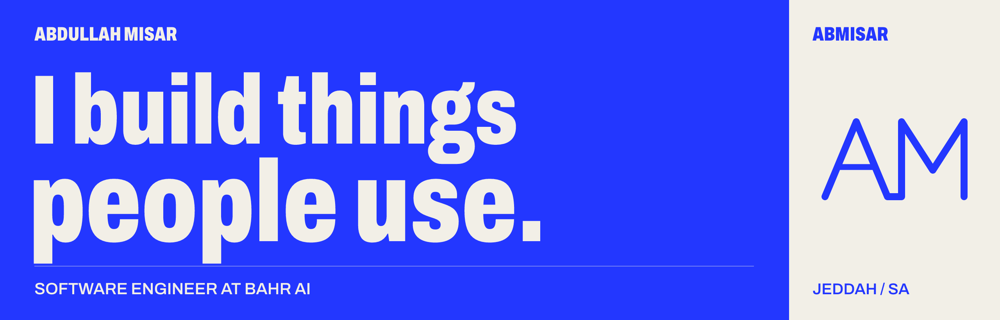
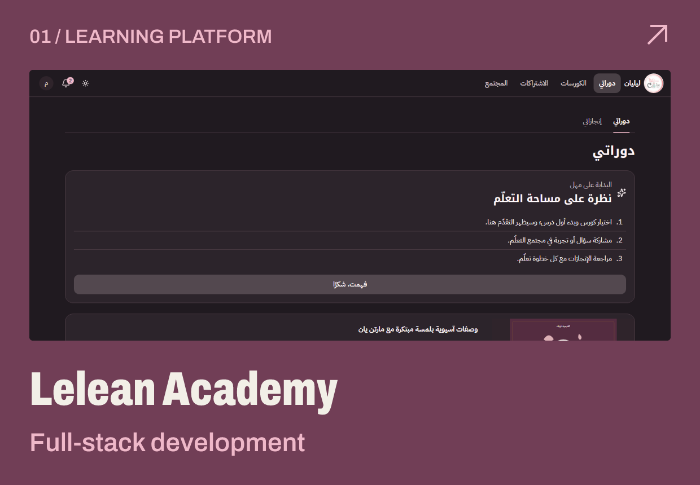
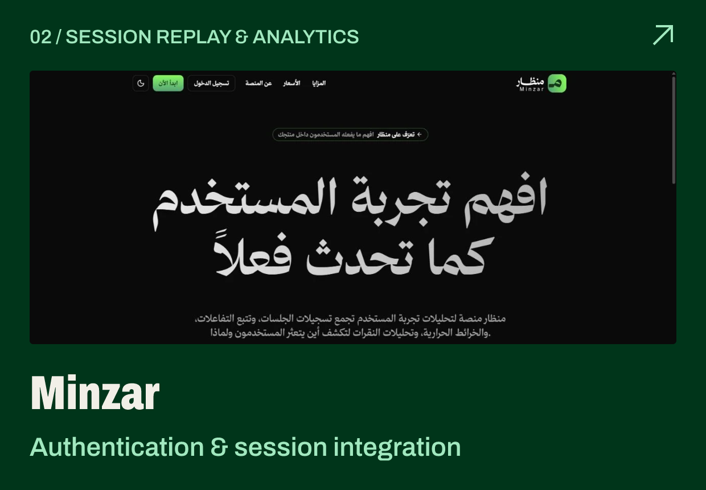
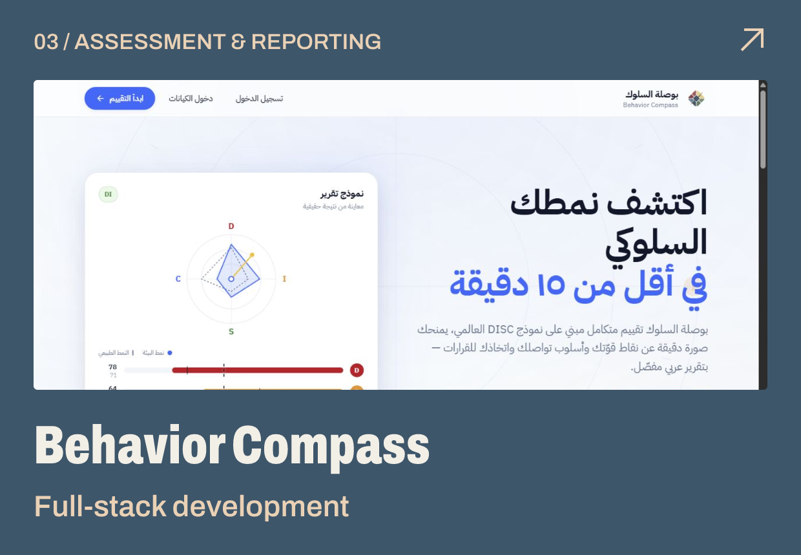
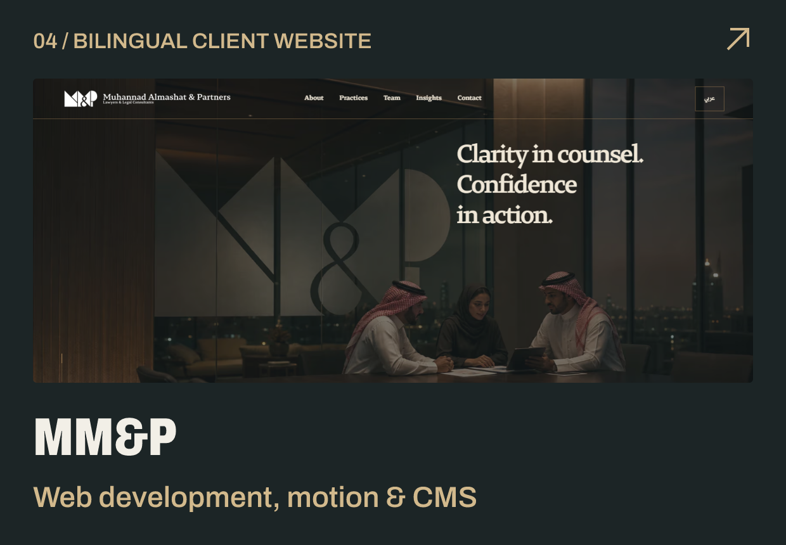
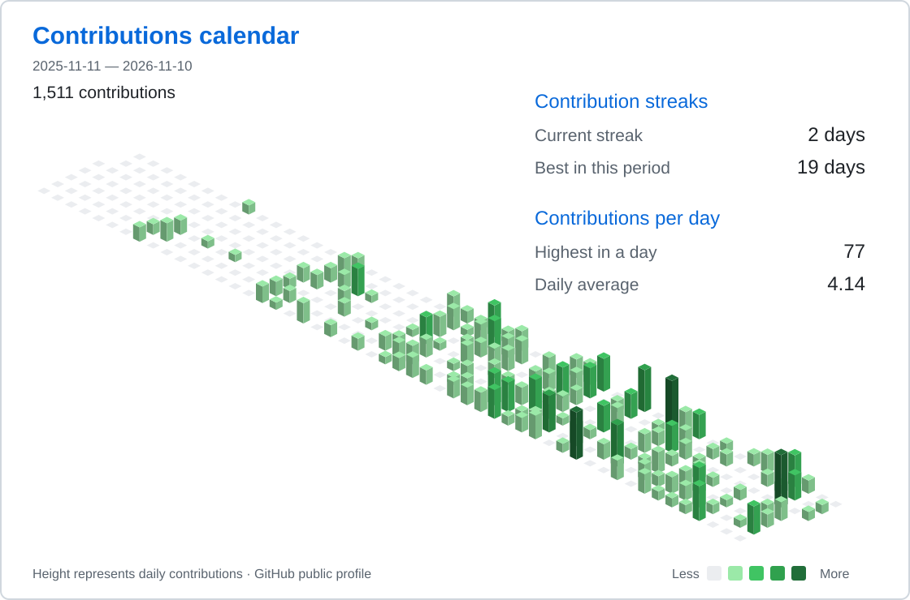

  <a href="https://www.abmisar.site/"><strong>PORTFOLIO ↗</strong></a> &nbsp; / &nbsp;
  <a href="https://www.linkedin.com/in/abdullah-misar/">LINKEDIN ↗</a> &nbsp; / &nbsp;
  <a href="mailto:abdullahwalid18@gmail.com">EMAIL ↗</a>

### Software Engineer at Bahr AI · Leader, GDG on Campus UJ

I build products across interfaces, APIs, and the systems underneath them: learning platforms, healthcare workflows, session replay, and Arabic-first client experiences. Based in Jeddah. Also studying Software Engineering at the University of Jeddah, with expected graduation in 2027.

## Selected work

  
  
  
  

- **[Lelean Academy](https://www.abmisar.site/work/lelean)** — Learner and admin workflows, course progress, discussions, and protected media. Full-stack development; in development.
- **[Minzar](https://www.abmisar.site/work/minzar)** — Authentication and sessions across a Next.js console, .NET services, and a Bun/Elysia gateway. Team platform.
- **[Behavior Compass](https://www.abmisar.site/work/behavior-compass)** — Assessment journeys, Arabic PDF reporting, and company administration, integrating the client's scoring API. Built with a team.
- **[MM&P](https://www.abmisar.site/work/mmp)** — Bilingual law-firm website with synchronized 3D motion and a GitHub-backed editorial CMS. Built with a team.

Also: **[Mueenak](https://www.abmisar.site/work/mueenak)**, backend and database design for prescription-refill workflows within a team; **[MASS](https://www.abmisar.site/work/mass)**, website design and development for a Saudi security company.

## Beyond the build

I lead **GDG on Campus, University of Jeddah** — **160+ members across 10 departments**. Our **DocuPilot team won first place** at the AI Innovation Bootcamp by GDG on Campus UJ × StartSmart. I also completed KAUST Academy's Advanced Bioinformatics program, contributing to team RNA-seq research.

**Working with** TypeScript · React / Next.js · Node.js / Bun · PostgreSQL · C# / .NET · Auth0 · Azure

## GitHub activity

<picture>
  <source media="(prefers-color-scheme: dark)" srcset="assets/activity-dark.svg" />
  
</picture>
