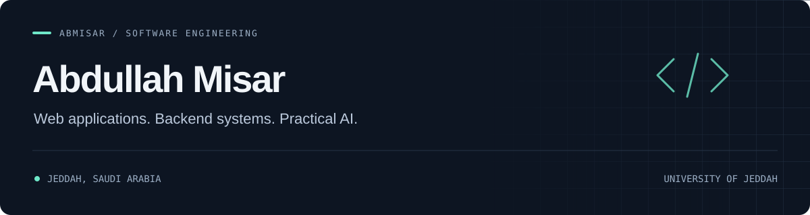

  

  <a href="https://www.abmisar.site/">Portfolio</a> &nbsp; / &nbsp;
  <a href="https://www.linkedin.com/in/abdullah-misar">LinkedIn</a> &nbsp; / &nbsp;
  <a href="https://github.com/Abmisar?tab=repositories">Repositories</a>

## Hi, I'm Abdullah

I'm a software engineering student at the **University of Jeddah**, based in Jeddah, Saudi Arabia. I build web applications, backend systems, and practical AI tools, with an interest in how data moves from storage to something people can use.

My projects span task-management tools for AI hosts, local search over lecture slides, and web applications for campus life. I've also explored bioinformatics through **KAUST Academy**, working with Python, Linux, and RNA-seq analysis pipelines.

## Selected projects

### [StudyMate MCP](https://github.com/Abmisar/studymate-mcp)
A small MCP server that lets an AI host list, add, and complete study tasks. Built as a readable teaching demo with typed tools, input validation, and a test client.

`Python` · `Model Context Protocol` · `Local JSON storage`

### [Slides RAG](https://github.com/Abmisar/Slides-RAG)
A local study assistant for PDF lecture slides. Extracts and indexes slide content, retrieves relevant passages, and answers questions using a local language model.

`Python` · `Streamlit` · `FAISS` · `sentence-transformers` · `Ollama`

### [UJ Campus Finder](https://github.com/Abmisar/UJ-Campus-Finder)
A team-built lost-and-found application for the University of Jeddah. I contributed as a **backend developer** to a project supporting item reports, claim requests, and administration workflows.

`JavaScript` · `Node.js` · `Express` · `MySQL`

## Tools I work with

| Area | Technologies |
| :--- | :--- |
| Languages | TypeScript, JavaScript, Python, SQL, Java |
| Web | React, Next.js, HTML, CSS, Tailwind CSS, EJS |
| Backend & databases | Node.js, Express, REST APIs, PostgreSQL, MySQL |
| AI & data | MCP, Streamlit, FAISS, Ollama, Pandas, NumPy |
| Development | Git, GitHub, Linux |

## Connect

Find more of my work on [my portfolio](https://www.abmisar.site/) or connect with me on [LinkedIn](https://www.linkedin.com/in/abdullah-misar).
